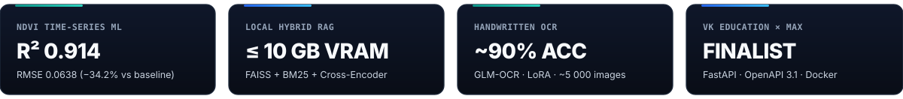

  

  
  
  

  

---

### Обо мне

Студент 3 курса РГУПС («Информационные системы и технологии», выпуск 2028), **финалист хакатона VK Education × MAX**.  
Проектирую веб-сервисы и REST/WebSocket API на **Python (FastAPI, PostgreSQL, Redis, Docker)** и довожу прикладные **ML/LLM-модели** от экспериментов до контейнеризированного продакшен-инференса.

---

### Технологический стек

  

- **Backend:** Python, FastAPI, SQLAlchemy 2.0, Alembic, Pydantic, PostgreSQL 16, Redis 7, REST API, WebSockets, OpenAPI 3.1, JWT, Docker Compose, Nginx, Caddy
- **AI / ML:** PyTorch, LoRA, LLM, Hybrid RAG (FAISS, BM25, Cross-Encoder Reranking, Ollama), GLM-OCR, Time-Series Feature Engineering, Pandas, NumPy

---

### Ключевые проекты

| Проект | Направление | Стек | Результат / Метрики |
| :--- | :--- | :--- | :--- |
| [**CyberShield**](https://github.com/TaCeiN/CyberShield) | `Backend` | FastAPI, SQLAlchemy 2.0, Alembic, PostgreSQL 16, Redis 7, WebSockets, Docker, Nginx | Симулятор кибербезопасности: **16 обучающих модулей**, ветвящиеся сценарии, JWT, геймификация и рабочий стенд |
| [**NDVI Монитор**](https://github.com/TaCeiN/kosmo-rostov-tsikady-19) | `ML / Data` | Python, ML (107 признаков), Google Earth Engine, FastAPI, Batch Inference | Восстановление рядов NDVI на 3 112 скрытых точках: **RMSE `0.06384`** vs `0.09695` (−34.2%), **R² `0.914`** vs `0.802`, `74.5%` в ±0.05 |
| [**RAG-CPU**](https://github.com/TaCeiN/RAG-CPU) / [**RAG**](https://github.com/TaCeiN/RAG) | `AI / Backend` | FastAPI, Ollama (`QVikhr-3-4B`), FAISS, BM25, Cross-Encoder, JWT | Локальный русскоязычный RAG в пределах **`10 GB VRAM / 16 GB RAM`**, фоновая индексация, NDJSON-стриминг и роутинг запросов |
| [**Домовой**](https://github.com/TaCeiN/domovoy) | `Backend / Bot` | OpenAPI 3.1, TypeScript / Node.js, Drizzle ORM, Docker Compose, Caddy | Мини-приложение и ИИ-бот ЖКХ для мессенджера MAX с интеграцией ГАР ФНС / ГИС ЖКХ / OSM |
| [**MindForge**](https://github.com/TaCeiN/MindForge) | `AI / Fullstack` | FastAPI, SQLAlchemy, JWT, RAG, SQLite, React, Nginx | Локальный аналог NotebookLM в монорепозитории с автомиграциями и `/api/healthz` |

---

### Хакатоны и достижения

- **2026** — Участник хакатона **ДГТУ Весна 2026**
- **2025** — Финалист хакатона **VK Education × MAX** (серверная архитектура мини-приложения для личной эффективности)
- **2025** — Участник хакатона **IT_One CUP**

---

  

